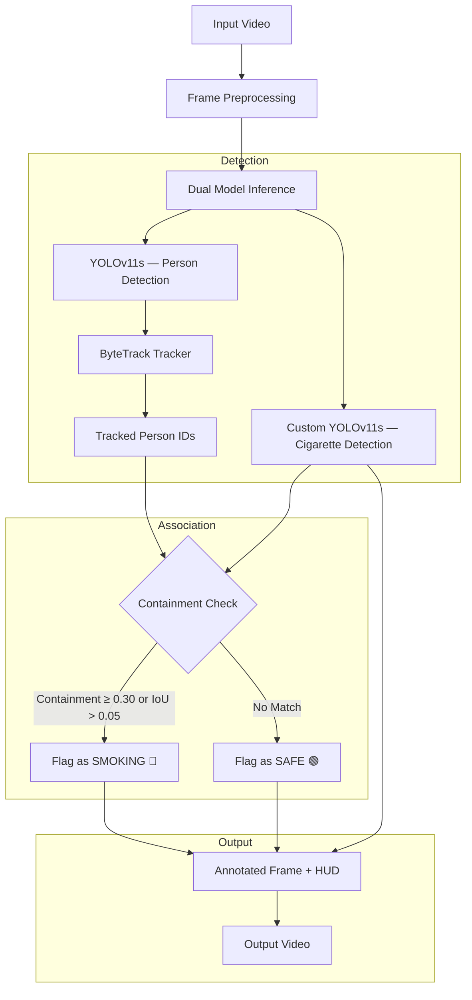

# Cigarette Detection in Restricted Areas 🚭

> I built a real-time smoking detection system using YOLOv11 and OpenCV — it watches a video feed, tracks every person with ByteTrack, and flags anyone holding a cigarette. This is my field project.

[](https://github.com/lavinpattnaikoffical-gif)
[](https://www.python.org/)
[](https://ultralytics.com)
[](https://opencv.org/)
[](https://opensource.org/licenses/MIT)

---

## What This Project Does

The idea is simple — point a camera at a restricted area (think petrol pumps, hospital entrances, factory floors), and the system will automatically:

1. **Detect every person** in the frame using a COCO-pretrained YOLOv11s model
2. **Track each person** across frames with ByteTrack (so person #5 stays person #5 even if they walk behind a pillar)
3. **Detect cigarettes** using my custom-trained YOLOv11s model (`best.pt`)
4. **Match cigarette → person** using a spatial containment algorithm I wrote
5. **Draw everything on screen** — green boxes for safe people, red boxes for smokers, orange boxes on cigarettes, and a live stats HUD

The output is a fully annotated video with all the detections, tracking IDs, and a "SMOKER DETECTED" alert banner whenever a violation is active.

---

## Why I Built This

I needed a project that solves an actual real-world problem, not just another classifier on a Kaggle dataset. Smoking in restricted zones is a genuine safety hazard — it causes fires at fuel stations, violates hospital regulations, and puts lives at risk in chemical plants. But most surveillance systems just record footage for someone to review *after* something goes wrong.

I wanted to build something that detects it *as it happens*.

The tricky part? A cigarette is *tiny* — maybe 30-50 pixels in a 1080p frame, while a person's bounding box is thousands of pixels. Standard IoU matching completely fails here because the union of a huge box and a tiny box makes the intersection ratio near zero. That's the core technical challenge I had to solve.

---

## How the Detection Actually Works

### Two Models, One Pipeline

I run two YOLO models on every frame simultaneously:

- **Model 1 — Person Detector** (`yolo11s.pt`): Pretrained on COCO, filtered to class 0 (person). This gives me bounding boxes for every human in the frame.
- **Model 2 — Cigarette Detector** (`best.pt`): This is my custom-trained model. I fine-tuned YOLOv11s on annotated cigarette datasets so it can pick up burning tips, filters, and cigarettes at weird angles.

### The Containment Ratio (My Solution to the Scale Problem)

Normal IoU doesn't work here. Here's why:

$$\text{IoU} = \frac{\text{Area}(B_{\text{person}} \cap B_{\text{cig}})}{\text{Area}(B_{\text{person}} \cup B_{\text{cig}})}$$

The person box is so much bigger than the cigarette box that the union is basically just the person box. IoU ends up being like 0.01 — way too low for any reasonable threshold.

So instead, I compute the **containment ratio**:

$$\text{Containment} = \frac{\text{Area}(B_{\text{person}} \cap B_{\text{cig}})}{\text{Area}(B_{\text{cig}})}$$

This asks: *"What fraction of the cigarette box is inside the person box?"* If 30% or more of the cigarette overlaps with a person → that person is flagged as smoking. I also keep a fallback IoU check of > 0.05 for edge cases where someone holds a cigarette just barely outside their body contour.

### ByteTrack for Persistent IDs

ByteTrack handles the tracking. It uses Kalman filtering and Hungarian matching to assign consistent IDs to people across frames. So if person #3 gets partially occluded for a few frames, they come back as #3, not some new ID.

---

## Architecture Overview



---

## Project Structure

```
Cigarette-detection/
├── Inference.py           # Main pipeline — runs both models, tracking, containment logic, HUD rendering
├── run_inference.py       # Quick single-model test script (cigarette model only, no tracking)
├── requirements.txt       # Dependencies
├── LICENSE                # MIT License
├── .gitignore             # Keeps model weights and videos out of git
└── README.md              # You're reading this
```

> **Note:** The model weights (`best.pt`, `yolo11s.pt`) and video files are excluded from git because they're large. Download instructions below.

---

## Setup & Installation

### What You Need
- Python 3.8+ (I used 3.10)
- Git
- NVIDIA GPU with CUDA (optional — it works on CPU too, just slower)

### Step 1: Clone It

```bash
git clone https://github.com/lavinpattnaikoffical-gif/Cigarette-detection.git
cd Cigarette-detection
```

### Step 2: Create a Virtual Environment

```bash
# Windows
python -m venv venv
venv\Scripts\activate

# Linux / macOS
python3 -m venv venv
source venv/bin/activate
```

### Step 3: Install Dependencies

```bash
pip install -r requirements.txt
```

Here's what gets installed:

| Package | Version | What It Does |
|---------|---------|-------------|
| `ultralytics` | ≥ 8.3.0 | YOLOv11 inference + ByteTrack tracking |
| `opencv-python` | ≥ 4.8.0 | Video I/O, drawing bounding boxes, HUD rendering |
| `numpy` | ≥ 1.24.0 | Math for bounding box geometry and containment calculations |

### Step 4: Download My Custom Model

The cigarette detection model I trained is hosted on Google Drive:

👉 **[Download best.pt](https://drive.google.com/file/d/1bVRSFUKuPyENUBAcZmGeOIHQh8gKLCn2/view?usp=sharing)**

Drop the downloaded `best.pt` into the project root folder. The person detection model (`yolo11s.pt`) downloads automatically the first time you run inference.

---

## Running It

### Full Pipeline (Person Tracking + Cigarette Detection + HUD)

Put your video file in the project folder, update the `VIDEO_IN` variable at the top of `Inference.py` if needed, then:

```bash
python Inference.py
```

This will:
- Process every frame through both models
- Track people with ByteTrack
- Run the containment association logic
- Render bounding boxes and the HUD panel
- Save the annotated output to `output_detected.mp4`

Progress logs print every 30 frames so you can see it working.

### Quick Cigarette-Only Test

If you just want to test the cigarette model without the full pipeline:

```bash
python run_inference.py
```

This runs `best.pt` alone with basic YOLO predict — no tracking, no containment logic.

---

## Configuration

All the key parameters are at the top of [`Inference.py`](Inference.py) — you can tweak them without touching anything else:

| Parameter | Default | What It Controls |
|-----------|---------|-----------------|
| `VIDEO_IN` | `"input_video.mp4"` | Path to your input video |
| `VIDEO_OUT` | `"output_detected.mp4"` | Where the annotated output gets saved |
| `PERSON_MODEL` | `"yolo11s.pt"` | Person detection model |
| `CIGARETTE_MODEL` | `"best.pt"` | My custom cigarette detection model |
| `PERSON_CONF` | `0.40` | Min confidence to count a person detection |
| `CIG_CONF` | `0.25` | Min confidence to count a cigarette detection |
| `IOU_THRESH` | `0.45` | NMS threshold for overlapping detections |
| `OVERLAP_THRESH` | `0.30` | Min containment ratio to associate cigarette → person |

---

## What the Output Looks Like

Here's a breakdown of everything drawn on each frame:

| Element | What You See |
|---------|-------------|
| 🟢 Green Box | Person is **safe** — no cigarette associated |
| 🔴 Red Box | Person is **smoking** — cigarette detected within their bounding box |
| 🟠 Orange Box | Detected cigarette object |
| `#ID person 0.XX` | ByteTrack ID + detection confidence |
| `cigarette 0.XX` | Cigarette detection confidence |
| Top-right HUD | Live counts — total persons, violations, safe |
| Bottom banner | **"SMOKER DETECTED"** alert when violations are active |

### Demo Screenshots

<div align="center">


<br/><br/>


<br/><br/>


</div>

---

## Performance

I tested this on different hardware to see how it scales:

| Hardware | Mode | Average FPS | Resolution |
|----------|------|-------------|-----------|
| NVIDIA RTX GPU | CUDA | ~42–60 FPS | 1080p |
| Intel / AMD CPU | CPU | ~12–18 FPS | 1080p |

On a decent GPU, it runs comfortably in real-time. On CPU it's slower but still usable for offline processing.

---

## Tech Stack

| Component | Technology |
|-----------|-----------|
| Object Detection | Ultralytics YOLOv11s (PyTorch) |
| Multi-Object Tracking | ByteTrack |
| Video Processing | OpenCV |
| Math / Geometry | NumPy |
| Dataset Annotation | CVAT |
| Language | Python 3.x |

---

## What I'd Add Next

There's a lot of room to extend this:

- **Edge deployment** — Export to TensorRT or ONNX for running on something like a Jetson Orin Nano
- **Alerts** — Push notifications via Telegram bot or webhooks when a violation is detected
- **Dashboard** — A Streamlit or FastAPI web app to monitor multiple camera feeds
- **Physical alarms** — Wire up a relay to trigger a siren or strobe light in hazardous areas
- **Incident logging** — Save timestamped violation snapshots with ByteTrack IDs to a database

---

## About Me

- **Name:** Lavin Pattnaik, Prajwalkumar J, R Thilak
- **GitHub:** [@lavinpattnaikoffical-gif](https://github.com/lavinpattnaikoffical-gif)
- **Project Repo:** [Field_Project-Cigarette_Detection](https://github.com/lavinpattnaikoffical-gif/Field_Project-Cigarette_Detection)
- **Domain:** Computer Vision, Deep Learning & Intelligent Surveillance

This is my field project submission — I designed the architecture, trained the custom model, wrote the inference pipeline, and built the visualization system from scratch.

---

## License

This project is licensed under the MIT License.
